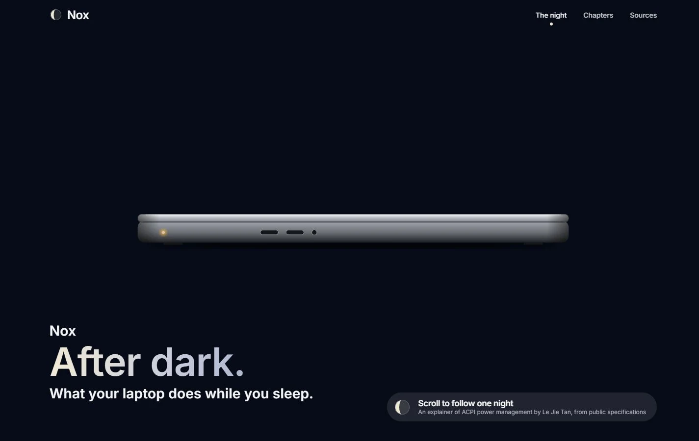
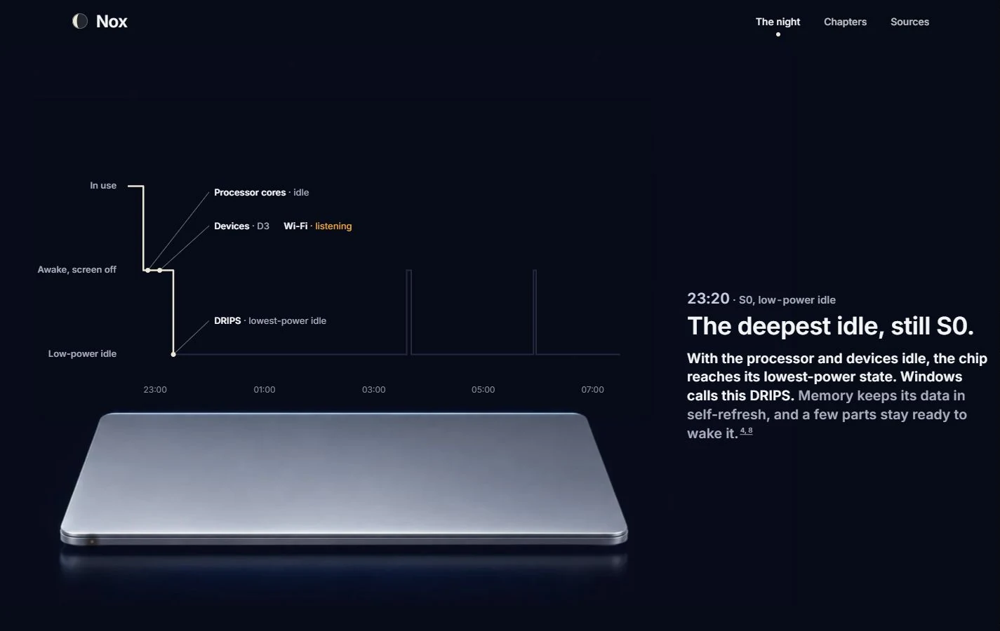
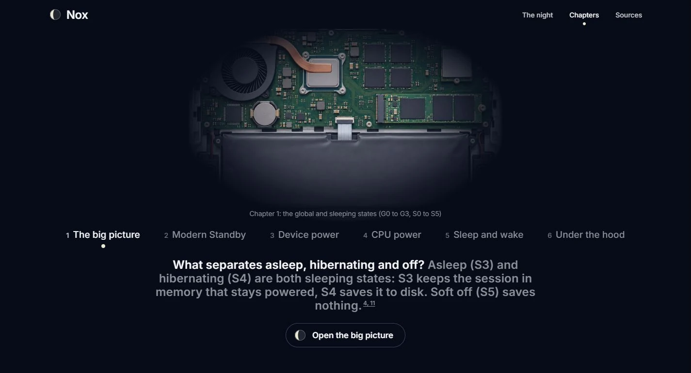
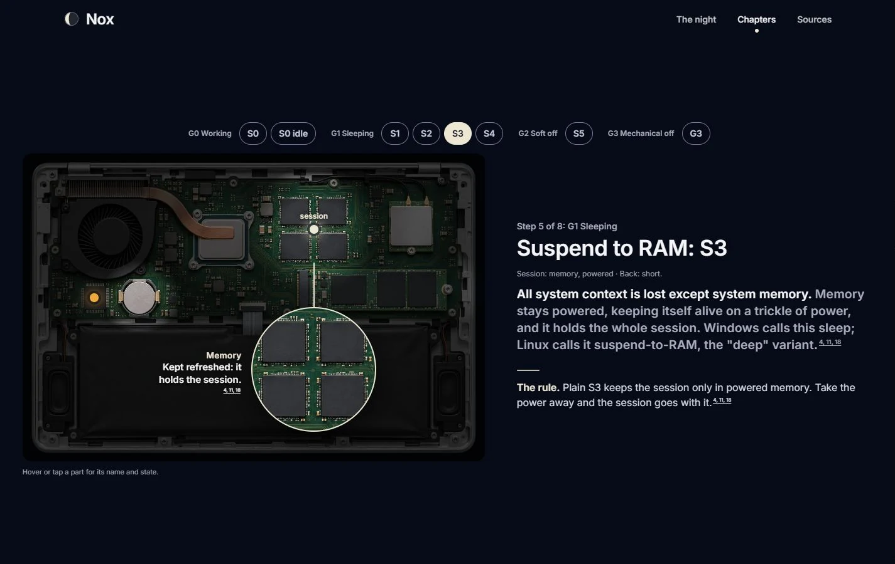
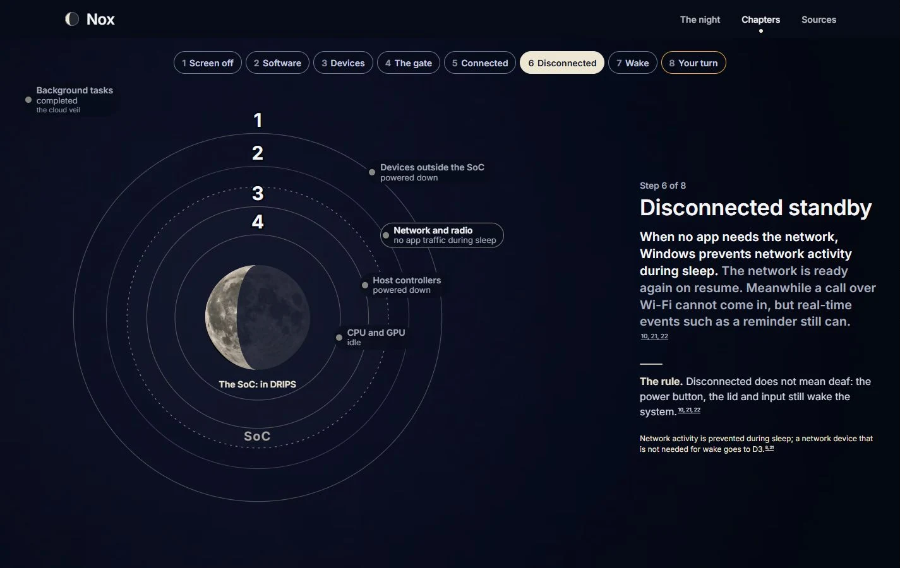
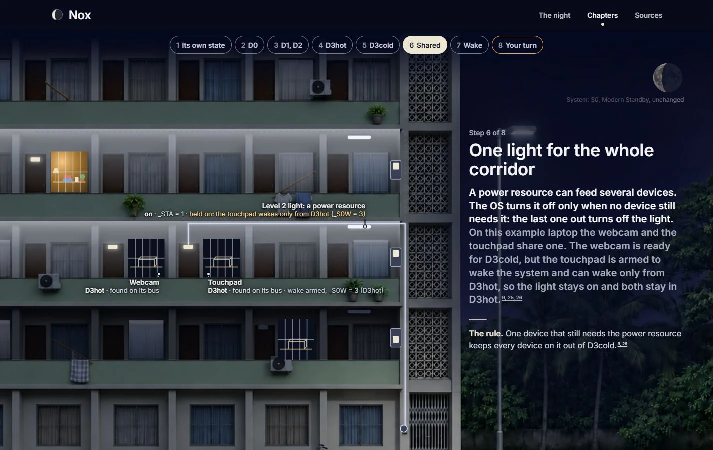
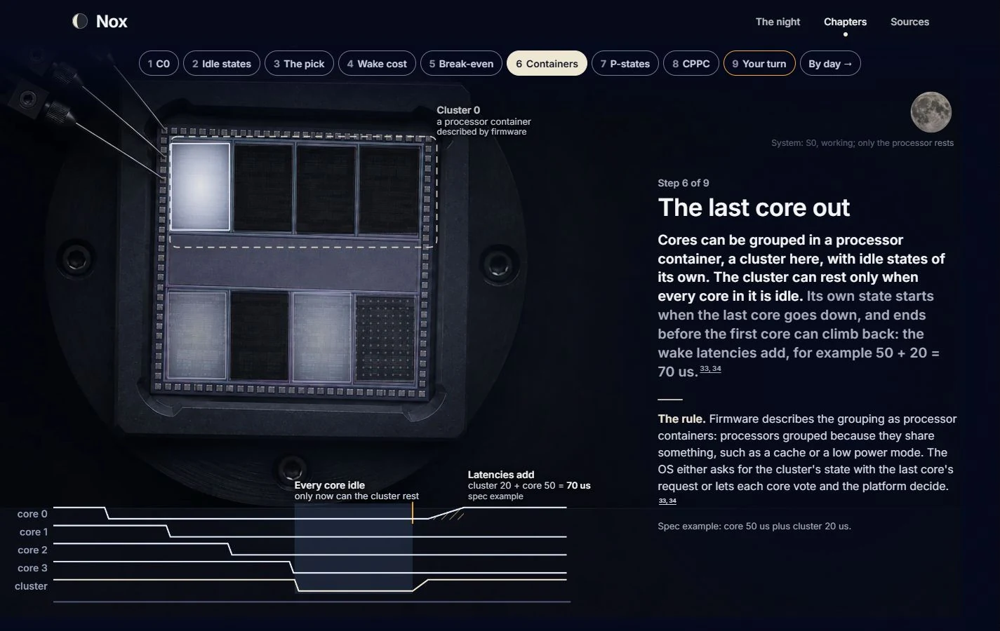
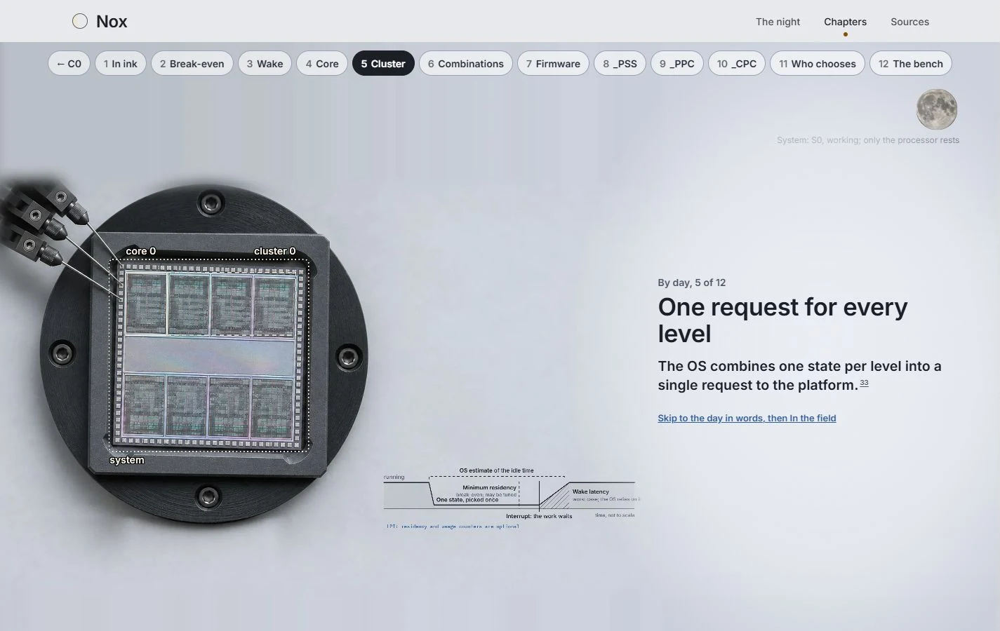
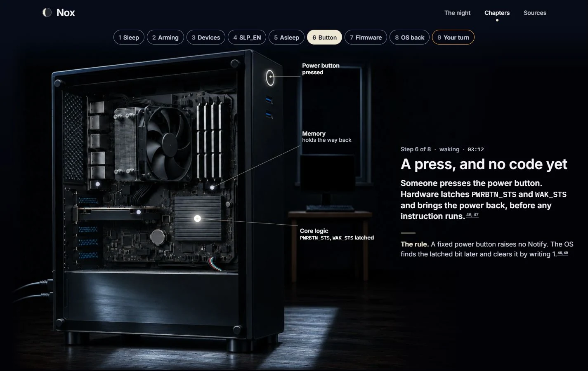
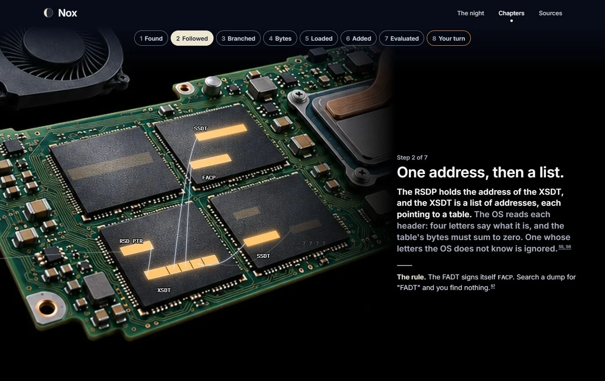

# Walkthrough

Ten screenshots of Nox as it runs, in the order a reader meets it: the main page, then one moment from each chapter. They were taken in Chromium at 1440 x 900 on 2026-11-12. The pictures inside the app are illustrations, not photographs of a real product.

A screenshot cannot show the part that took the most work, which is how the picture changes as you scroll. To see that, run the app (see the [README](../README.md#run-it)).

## The main page

### The opening

The page opens on a closed laptop. As the reader scrolls, the lid opens and the story of one night begins.

### One night, one line

The story follows the laptop from 22:47 to 07:30 in ten stops. While the lid is shut, the night is drawn as one line above the laptop, and each stop adds one thing to it. Here, at 23:20, the processor and the devices are idle and the chip has reached its deepest idle state, still in S0. The small numbers after a sentence are its sources.

### The chapter list

After the story, six chapters go one layer deeper each. Each has its own picture and one question it answers.

## The chapters

### 1. The big picture

One board, eight states from working to mechanical off. Light is the state: a part that still has power is lit, the rest is dark. A cream point marks where the session is kept, and an amber point marks what is kept to wake the machine. In S3 only the memory still holds the session.

### 2. Modern Standby

A laptop in Modern Standby looks asleep but stays in S0. The moon's phase is how deeply the chip rests, and the four rings are the things that must go quiet before it can reach its deepest idle. This step is disconnected standby, where no app traffic is allowed during sleep.

### 3. Device power

Each flat is a device and each corridor light is a power resource. Here the webcam and the touchpad share one light. The touchpad is armed to wake the system and can do that only from D3hot, so the light stays on and both devices stay in D3hot.

### 4. CPU power, by night

A processor die on a test bench. Each tile is a core, and its brightness is its state. The lines under the die trace the same moments over time: the cluster can rest only when its last core has gone idle, and on the way back the wake latencies add.

### 4. CPU power, by day

The same bench the next morning. The night's ideas are written on it in ink, with the detail the night left out: here the three levels that each have idle states of their own.

### 5. Sleep and wake

One desktop PC through one S3 cycle, in order. This is the first moment of waking: the button is pressed, hardware latches two status bits and brings the power back, and no instruction has run yet.

### 6. Under the hood

The firmware's tables, drawn as chips on a board. The operating system starts from one address, follows it to a list, and follows the list to each table. The chapter goes on to how those tables are read and run.
